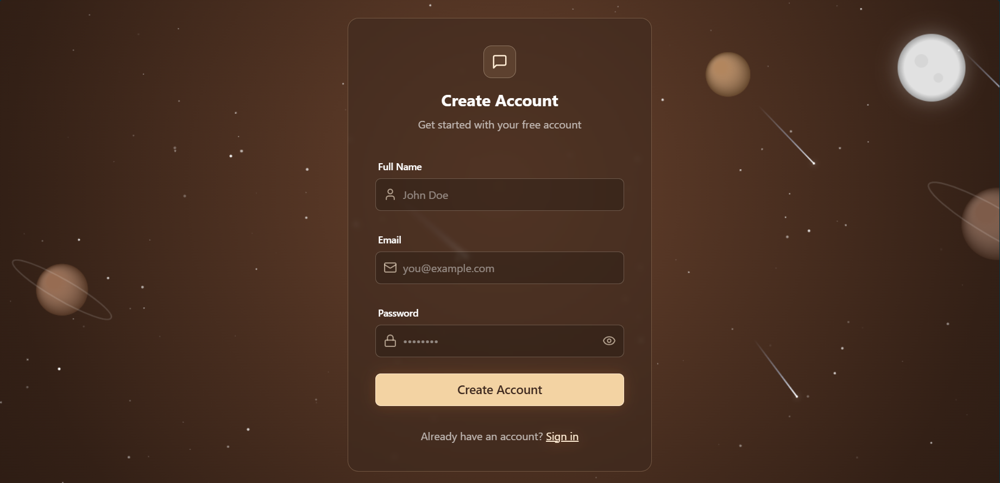
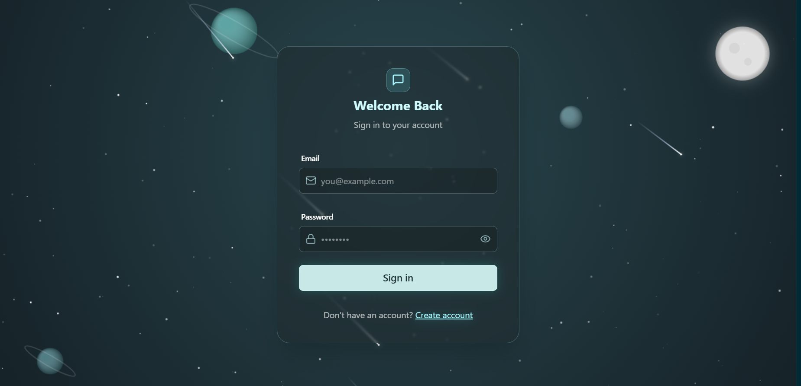
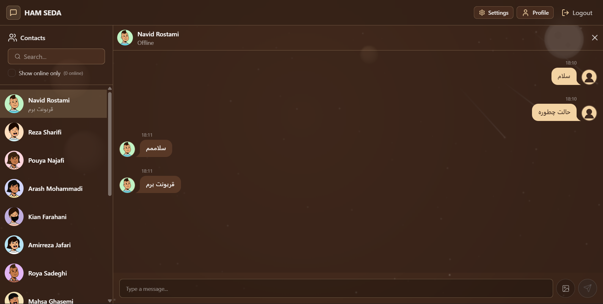
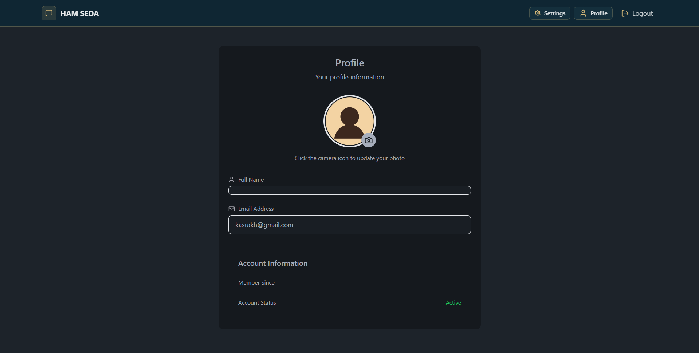
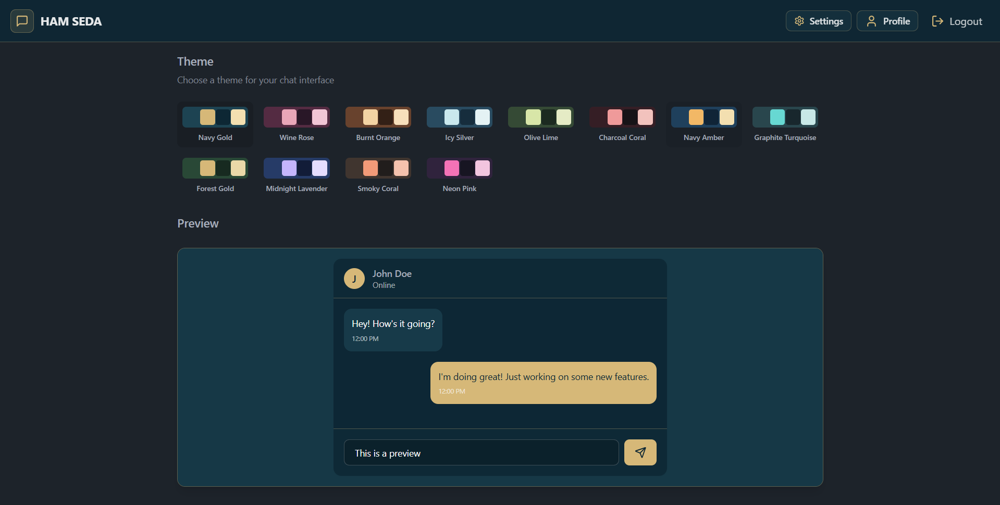

<div align="center">

# 💬 Real-Time Chat Application

### Instant messaging, powered by WebSockets

A modern real-time chat application built with **Node.js, React, and MongoDB**, supporting instant messaging and live communication.

[](https://react.dev)
[](https://nodejs.org)
[](https://expressjs.com)
[](https://socket.io)
[](https://www.mongodb.com)

</div>

---

## 🚀 Features

- ⚡ **Real-time messaging** — instant delivery powered by Socket.io
- 👥 **Online users detection** — see who's active right now
- 💬 **Private chat system** — 1:1 conversations between users
- 🔐 **Secure backend** — built with Node.js & Express
- 📦 **MongoDB integration** — persistent chat history & user data
- 🎨 **Responsive UI** — clean, modern interface built with React
- 🎨 **12 Custom Themes** — personalize the chat experience with 12 unique themes

---

## 📎 Supported File Types

Users can send and receive the following file types directly within the chat interface:

| Type | Icon |
|---|---|
| Images | 🖼️ |
| Videos | 🎥 |
| PDF Documents | 📄 |
| Audio Files | 🎵 |

All files are uploaded and shared right inside the conversation — no separate tools needed.

---

## 🧠 Tech Stack

### Frontend
| Technology | Purpose |
|---|---|
| **React** | UI library |
| **JavaScript (ES6+)** | Application logic |
| **HTML5 / CSS3** | Markup & styling |

### Backend
| Technology | Purpose |
|---|---|
| **Node.js** | Runtime environment |
| **Express.js** | REST API server |
| **Socket.io** | Real-time, bidirectional communication |

### Database
| Technology | Purpose |
|---|---|
| **MongoDB** | Storing users, messages & chat history |

### Tools
| Tool | Purpose |
|---|---|
| **Git & GitHub** | Version control |
| **VS Code** | Development environment |
| **Postman** | API testing |

---
## Video demo 

https://github.com/user-attachments/assets/f0c6fe06-9462-44b4-b438-6f309e6dd54b

---

## 📸 Screenshots

<table>
  <tr>
    <td align="center">
      
      <br/>
      <b>Sign Up</b>
    </td>
    <td align="center">
      
      <br/>
      <b>Login</b>
    </td>
    <td align="center">
      
      <br/>
      <b>Main Page</b>
    </td>
  </tr>

  <tr>
    <td align="center">
      
      <br/>
      <b>Profile Page</b>
    </td>
    <td align="center">
      
      <br/>
      <b>Settings Page</b>
    </td>
    <td align="center">
      
      <br/>
      <b>Additional Screenshot</b>
    </td>
  </tr>
</table>

---

## ⚙️ Installation & Setup

### 1. Get the project
Download the project files and open the project folder in Visual Studio Code.

### 2. Install dependencies
Open a terminal in the project's root directory and run:
```bash
npm run install:all
```

### 3. Run the app
Start the entire application (frontend + backend) with:
```bash
npm run dev
```

### 4. Open it in your browser
Once running, a local URL will appear in the terminal. Click it (or paste it into your browser) to reach the Login / Sign Up page.

### 5. Log in
You can either create a new account, or log in with one of the pre-seeded demo users below.

---

## 👤 Seeded Users

Before logging in, run the seed file to create the sample users:

```bash
node server/seeds/seed.js
```

After the seeding process is complete, you can log in using any of these email addresses:

- `pouya.najafi@example.com`
- `reza.sharifi@example.com`
- `navid.rostami@example.com`

### Default Password

Use the default password (123456) defined in the seed file (`server/seeds/seed.js`) to log in. 

---

## 📄 License

This project is open source and available under the [MIT License](LICENSE).

---

<div align="center">
Made with ❤️ using React, Node.js & Socket.io
</div>
